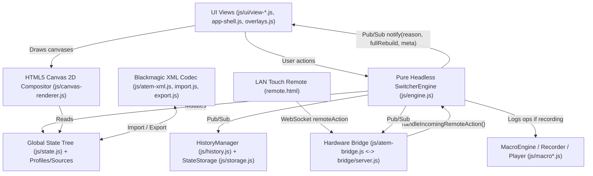

# 1. Programming Architecture & Core Engine

ATEM-PROG uses a **zero-build, modular IIFE architecture** in plain ES6+ JavaScript. Every file exposes a single well-defined global module (such as `SwitcherEngine`, `CanvasRenderer`, `MacroEngine`, `StateStorage`, `ViewSwitcher`) loaded in deterministic dependency order by `ATEM-PROG.html`.

This design keeps startup instantaneous, eliminates bundler/transpiler overhead, works directly from `file://` or `http://`, and allows the exact same engine files to run headlessly inside Node.js (`tests/run-tests.js`) as well as in the browser.

---

## Architectural Layers

---

## Script Load Order (`ATEM-PROG.html`)

Scripts are ordered in four clean tiers so lower layers never depend on UI code:

1. **Core State, Specs & Headless Engine:**
   `profiles.js` → `state.js` → `sources.js` → `atem-xml.js` → `layout.js` → `engine.js` → `history.js` → `storage.js` → `templates.js`
2. **Real-Time Video, Rendering & I/O Services:**
   `live-video.js` → `canvas-renderer.js` → `popout.js` → `atem-bridge.js`
3. **Macros, XML Import/Export & Documentation Outputs:**
   `macro.js` → `record-macro.js` → `playback-macro.js` → `import.js` → `export.js` → `patch-sheet.js`
4. **UI Shell & Views:**
   `view-start.js` → `view-switcher.js` → `view-compose.js` → `view-routing.js` → `view-macros.js` → `view-media.js` → `overlays.js` → `app-shell.js`

---

## Global State Model (`js/state.js`)

A single mutable `state` object holds the entire virtual switcher configuration. Keeping all config in one serializable tree makes Undo/Redo, `localStorage` autosave, `.atemprog.json` export, XML export, and remote synchronization straightforward.

Key top-level properties:
- `projectName`, `deviceProfile`, `canvas: { width, height, frameRate }`
- `workspaces`: Fixed array of 6 workspace slots — **4 M/Es** (`id: 0..3, type: "me", resourceId: 0..3`) and **2 SuperSources** (`id: 4..5, type: "superSource", resourceId: 0..1`). Hardware profiles gate which ones are exposed via `isWorkspaceAvailable(ws)`.
  - Each M/E `data` holds: `source` (PGM), `previewSource` (PVW), `transitionStyle`, `transitionRate`, `transitionProgress`, `previewTransition`, `transitionParams`, `ftb: { enabled, rate, progress }`, `nextTransition: { bkgd, usk: [bool×4] }`, and `usk: [4 layers]`.
  - Each SuperSource `data` holds: `artSource`, `artKeySource`, `artPlace` (`"Background" | "Foreground"`), keying params, and `boxes: [4 layers]`.
- `dsks`: Array of 4 Downstream Keyers (`createDSK(0..3)`), gated by `profile.downstreamKeyers`.
- `inputs`: Sparse map `{ [1..40]: { label, shortName, notes, thumbnail, thumbnailImage } }`.
- `outputs`: Sparse map `{ [1..24]: { label, shortName, notes, source, thumbnail, thumbnailImage } }`.
- `media`: Array of Media Pool assets (`still` or `video` clip, with `blob:` object URLs and cached `_image` / `_video` handles).
- `mediaPlayers`: 4 Media Player slots `{ id: 1..4, mediaId }`.
- `multiViews`: 4 MultiViewer definitions (`layout`, `swapPvwPgm`, `safeArea`, `vuMeters`, `windows[16]`).
- `macros`: 100-slot array (`0..99`) of `{ index, name, description, hotkey, ops: [...] }`.
- `busFollowRules`: Array of ATEM 10.2 Bus Mapping rules (Constellation models).
- `customSSPresets` & `customBusPages`: User-created SuperSource layouts and universal Source Bus filter pages.
- `resources.dves`: Hardware DVE allocator pool tracking which USKs currently hold a DVE channel.

---

## Hardware Profiles & Capability Gating (`js/profiles.js` & `js/sources.js`)

`profiles` defines 18+ real Blackmagic ATEM models across **Mini**, **SDI**, **Television Studio (TVS)**, and **Constellation (1/2/4 M/E HD, 4K, 8K)** lines. Every model declares exact counts for `inputs`, `me`, `upstreamKeyers`, `downstreamKeyers`, `dves`, `superSource`, `mediaPlayers`, `mediaPoolStills`, `mediaPoolClips`, `assignableOutputs`, and `supportsBoxBorders`.

Centralized capability helpers enforce real hardware rules across the entire UI and engine:
- `getUpstreamKeyersPerME(profile)` — Returns per-M/E USK count (e.g. 1 on Mini Pro, 4 on Extreme/Constellation).
- `getMultiViewerCount(profile)` — Scales MV count accurately per profile (1 to 4).
- `supportsBusMapping(profile)` — Returns `true` only for **Constellation** profiles; hides the Bus Mapping tab and skips Bus Follow template wiring on Mini/SDI/TVS models.
- `getMediaPoolLimits(profile)` — Enforces real clip capacities (`0` clips on ATEM Mini/SDI; stills-only upload restriction).
- `isSourceValidForDestination(destType, sourceId, targetWs)` (`js/sources.js`) — Prevents illegal self-routing loops and enforces upstream-only M/E cascade rules (e.g., M/E 2 can feed M/E 1, never M/E 1 into M/E 2).

---

## Headless `SwitcherEngine` & Pub/Sub Event Bus (`js/engine.js`)

**Rule of thumb:** UI views should **never** mutate routing or switching state silently — they call `SwitcherEngine.*` methods.

Every `SwitcherEngine` setter follows a consistent 4-step pattern:
1. **Validate** inputs against hardware limits and `isSourceValidForDestination()`.
2. **Mutate** `state` (and propagate ATEM 10.2 Bus Follow rules if applicable).
3. **Log** the official Blackmagic XML op to `MacroRecorder` (if recording is active).
4. **Emit** `notify(reason, fullRebuild, meta)` to all subscribers.

### Exact Event Metadata
Notifications carry `{ reason, fullRebuild, me, dsk, aux, ss, box, usk }`:
- `AppUI` (`app-shell.js`) listens to `SwitcherEngine.subscribe`:
  - High-frequency frame ticks (`transitionAutoFrame`, `dskAutoFrame`, `ftbFrame`) call `renderLiveTick()` (canvas-only repaint, zero DOM teardown).
  - Structural/state changes coalesce via `requestAnimationFrame` (`queueRender()`) and preserve scroll positions inside panels.
- `HistoryManager` records an undo snapshot on non-transient mutations.
- `StateStorage` schedules an 800ms debounced `localStorage` write.
- `AtemBridge` uses the exact `{ me, dsk, aux, usk, ss, box }` metadata to forward the exact command to connected ATEM hardware **and** broadcast an updated `studioState` to `remote.html`.

---

## Canvas 2D Compositor & Media Clip Playback (`js/canvas-renderer.js`)

`CanvasRenderer` is a pure HTML5 Canvas 2D broadcast rasterizer capable of rendering recursive source graphs (e.g., `Camera 1` → `SuperSource 1` → `M/E 2` → `M/E 1` with USK + DSK → `MultiViewer` → `Popout Window`) with cycle protection (`renderStack`).

### Rendering Pipeline
1. **Scratch Canvas Pool (`acquireCanvas` / `releaseCanvas`):** Reuses offscreen canvases per resolution and separates `willReadFrequently: true` (CPU pixel keying for Luma/Chroma/Linear keys) from default GPU-accelerated contexts (plain image/video blits) to prevent frame drops.
2. **Layer Compositing Order (M/E):**
   - Background (`source`, or blended `source` ↔ `previewSource` during `Mix`/`Dip`/`Wipe`/`DVE` transitions)
   - Upstream Keyers `USK 1..4` (Luma, Linear fill+key, Chroma, Pattern, or DVE transform with crop, border, shadow, mask)
   - Downstream Keyers `DSK 1..4` (composited on M/E 1 only, matching ATEM hardware; respects `TIE` on Preview)
   - Fade to Black (`ftb.progress`)
3. **ATEM-Accurate Media Clip Behavior:**
   - Video clips stay **cued at frame 0** when sitting on Preview or Compose (no continuous background RAF loop).
   - `syncLiveMediaClips()` walks all live M/E Program buses, On-Air USKs/DSKs, SuperSource boxes, and Aux outputs. When a clip enters live Program, it auto-starts from `0:00`; when it leaves Program, it pauses and rewinds to `0:00`.
   - Operators can manually Pause/Play or Stop & Rewind via `CanvasRenderer.controlMediaClip(mediaId, "toggle" | "stop")`.
   - The video animation tick loop automatically halts when `document.hidden` is true or no clip is actively playing.

---

## Undo/Redo, Persistence & Portable Show Files (`js/history.js` & `js/storage.js`)

### 1. Compact Snapshots (`HistoryManager`)
`captureCompactState()` serializes the config tree while stripping heavy runtime properties (`url`, `blob`, `_image`, `_video`, `_keyCanvas`, `thumbnail`, `thumbnailImage`). Snapshots stay under ~30 KB, keeping Undo/Redo instantaneous and preventing `localStorage` quota overflow.

### 2. Two-Tier Auto-Persistence (`StateStorage`)
- **Config (`localStorage` key `atem_prog_state_v1`):** Debounced synchronous JSON write (800ms) + `beforeunload` flush.
- **Binary Assets (IndexedDB `atem_prog_assets_v1`):** Stores Media Pool stills/video blobs (up to 150 MB cap) in the `media` store and Input/Output thumbnails in the `thumbnails` store. On boot, config restores synchronously and binary blobs hydrate asynchronously via `restoreBinaryAssets()`.

### 3. Portable Show Files (`.atemprog.json`)
`StateStorage.exportShowFile()` / `importShowFile()` bundles everything needed to move a show between computers:
- `format: "atem-prog-show"`, `version: 1`
- `state`: Compact show configuration (inputs, routing, M/Es, USKs, DSKs, SuperSource, MultiViews, Macros, Bus Follow rules, custom presets & bus pages)
- `uiPrefs`: Switcher M/E layout, Custom Multi-M/E layout, Saved Layout Presets, and theme
- `mediaAssets` & `thumbnails`: Optional base64-encoded stills/clips and input/output thumbnails
- **Rollback Safety:** `importShowFile()` snapshots the current state and UI prefs before importing; if parsing or hydration throws any error, it automatically rolls back to the prior state.
