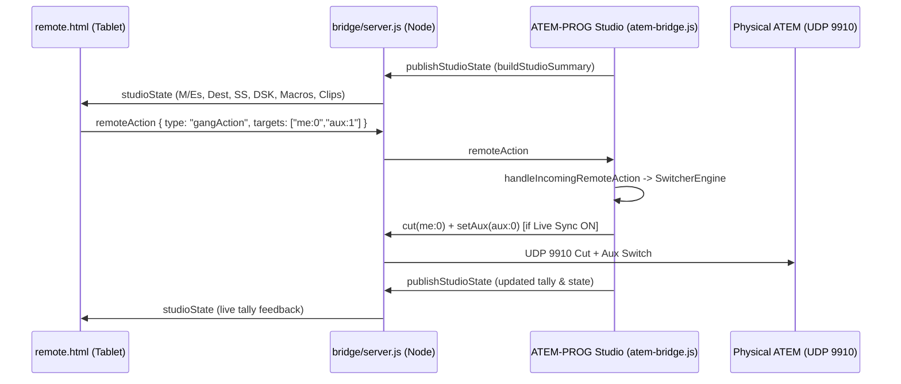

# 4. Hardware ATEM Bridge, Touch Remote & Testing

This guide explains how ATEM-PROG communicates with physical Blackmagic Design ATEM switchers over Ethernet, how tablets and phones connect via the LAN Touch Remote, and how to run the automated test suites.

---

## Local Bridge Server (`bridge/server.js`)

Browsers cannot speak Blackmagic's proprietary **UDP port 9910** ATEM protocol directly. `bridge/server.js` is a lightweight Node.js service (dependencies: `ws` and `atem-connection`) that runs on your host computer (default `http://0.0.0.0:8993`) and performs three jobs:

1. **Path-Sandboxed Static HTTP Server:** Serves `ATEM-PROG.html`, `remote.html`, `launcher.html`, and `tests.html` with `Cache-Control: no-store` so LAN devices always load fresh assets.
2. **Launcher Status API (`/api/status`):** Reports active LAN IPv4 addresses, connected WebSocket client count, ATEM connection status, and rolling service logs.
3. **WebSocket Hub (`ws://<host>:8993`):**
   - Relays hardware commands (`connect`, `disconnect`, `discover`, `setProgram`, `setPreview`, `cut`, `auto`, `ftb`, `setAux`, `setDSKOnAir`, `setDSKTie`, `autoDSK`, `setUSKOnAir`, `setUSKFill`, `setSSBox`, `runMacro`, `pullConfig`, `pushConfig`, `captureStill`, `downloadStill`) to the physical ATEM via `atem-connection`.
   - Performs raw **mDNS (`_blackmagic._tcp.local`)** LAN discovery over UDP multicast `224.0.0.251:5353` so switchers appear automatically without typing IP addresses.
   - Relays `publishStudioState` and `remoteAction` messages transparently between the main Studio Web UI and all connected `remote.html` touch clients.

---

## Browser Bridge Client & Live Sync (`js/atem-bridge.js`)



### Live Sync & Echo Suppression
- When **Live Sync** is toggled on in the Live I/O modal (`js/ui/overlays.js`), `AtemBridge` subscribes to `SwitcherEngine` events and forwards each mutation to the connected ATEM.
- Inbound `state` snapshots from the physical ATEM set an internal `_applyingHardwareEcho = true` flag while updating local `state`, preventing infinite Studio ↔ ATEM command feedback loops.
- **Pull / Push Config:**
  - **Pull from ATEM (`pullFullConfig`):** Downloads live input names, M/E Program/Preview, Aux routes, SuperSource boxes, and MultiViewer window assignments into ATEM-PROG.
  - **Push to ATEM (`pushConfig`):** Pushes your pre-programmed input labels, Aux routes, M/E states, SuperSource box layouts, and MultiViewer layouts to the physical switcher.
- **Still Capture & Media Pool Download:** `captureStillToInput()` grabs a live Program frame from the ATEM and assigns it as an input thumbnail; `pullStillToMediaPool()` downloads an ATEM Media Pool still (RGBA → BMP data URL) directly into ATEM-PROG's Media Pool.

---

## LAN Touch Remote (`remote.html`)

`remote.html` is a standalone, zero-dependency tablet/phone web app served directly from the bridge (`http://<host-lan-ip>:8993/remote.html`). Because all remote actions flow through `AtemBridge.handleIncomingRemoteAction()` → `SwitcherEngine`, **anything you tap on the tablet updates the main Studio UI AND switches connected physical ATEM hardware automatically**.

### Studio ↔ Remote Protocol
- **Studio → Remote (`studioState`):** Built by `AtemBridge.buildStudioSummary()` (throttled every 80ms on state changes). Includes:
  - `mixEffects`: `program`, `preview`, `ftb`, `transitionStyle`, `transitionRate`, `previewTransition`, `nextTransition`, `usks`, valid `sources` & `uskSources`.
  - `auxOutputs` & `outputSources`, `dsks` & `dskSources`.
  - `superSources` (boxes, art, valid sources) & `ssPresets` (compact geometric box definitions — `remote.html` generates its own numeric SVG wireframes locally with zero raw HTML injection).
  - `macros`: All populated slots (`0..99`) with `LIVE` / `PVW` / `EMPTY` impact metadata.
  - `activeClips`: Currently loaded Media Player video clips (`mpNum`, `mediaId`, `playing`, `isLive`).
  - `customBusPages`: Universal custom bus filter pages from the main Studio.
- **Remote → Studio (`remoteAction`):** Supports `setProgram`, `setPreview`, `cut`, `auto`, `ftb`, `setTransitionStyle`, `setTransitionRate`, `togglePrevTrans`, `toggleNextTrans`, `toggleUSK`, `setUSKSource`, `setAux`, `toggleDSK`, `autoDSK`, `toggleDSKTie`, `setDSKSource`, `setSSBoxEnabled`, `setSSBoxSource`, `setSSArtSource`, `applySSPreset`, `gangAction`, `controlMediaClip`, and `runMacro`.

### Remote Tabs & Touch Ergonomics
- **`Switch`:** Single-M/E desk with per-M/E independent Bus Filter Pages, `PGM`/`PVW` row toggles, side-by-side **`PVW | PGM`** tablet layout, toggleable Transition sections (`Style`, `Next`, `Take`), `Mix/Dip/Wipe/DVE` + frame rate stepper + `PREV`, Next Trans (`BKGD`, `K1..K4`), and direct `K1..K4` On-Air pills.
- **`★ Custom`:** **Multi-Target Gang Transition** panel (assign any mix of M/Es & Auxes, including 0 armed; `CUT ALL` / `AUTO ALL` / `FTB ALL`) + responsive **Multi-M/E desk cards** with per-card bus pages and PGM/PVW toggles.
- **`Dest / Aux`:** Tactile **Destination Source Bus** (Auxes, USK Fills, DSK Fills, SuperSource Boxes & Art) with universal custom pages, defaulting to **PGM-only** with optional **Virtual `PVW` staging + flip-flop `CUT`**, plus an **All Auxes** quick list.
- **`SuperSource`:** Auto-shown on models with SuperSource — `SS 1 / SS 2` selector, 1-click SVG wireframe **Layout Presets**, Box 1–4 On-Air & source selectors, and Art Fill picker.
- **`DSK` / `Macros` / `Tally`:** DSK `ON AIR / AUTO / TIE` + fill picker; Macro Bank `1–10` / `All` filter with **`● LIVE`** / **`◐ PVW`** badges; multi-M/E full-screen **Tally** lamp.
- **Global Controls:** Inline **Media Clip Pause/Stop** bar when clips are loaded, **`S / M / L`** button scaling, theme cycling, scroll preservation across live broadcasts, and `localStorage` persistence (`atemProg_remotePrefs_v2`).

---

## Automated Testing (`tests/`)

ATEM-PROG has two complementary automated regression suites covering both pure headless engine logic and live browser DOM/Canvas rendering:

### 1. Node.js CLI Engine Suite (`tests/run-tests.js`)
Runs all 32 headless tests in `tests/engine.test.js` (profiles, cascade rules, transitions, T-Bar, PREV TRANS, FTB, USK keyframes, ATEM 10.2 Bus Follow, XML codec, Macros, Undo/Redo, Storage, Templates, Granular Snapshots, and `.atemprog.json` round-trips) with zero browser overhead:
```powershell
& 'C:\Program Files\nodejs\node.exe' tests/run-tests.js
```
*(31 passed, 1 skipped — the native `DOMParser` XML round-trip test runs in the browser suite.)*

### 2. Full Headless Browser Engine + UI E2E Suite (`tests/run-browser-tests.js` & `tests.html`)
Launches an isolated headless Edge/Chrome instance via Chrome DevTools Protocol against `tests.html`, runs **all 42 tests** (32 Engine + native `DOMParser` XML round-trip + 10 live DOM/Canvas UI & `remote.html` E2E tests), checks for zero uncaught runtime exceptions, and preserves your real `localStorage` data automatically:
```powershell
& 'C:\Program Files\nodejs\node.exe' tests/run-browser-tests.js
```
You can also open `http://127.0.0.1:8993/tests.html` directly in your browser at any time to run and inspect results visually.

### Adding New Tests
- **Pure logic / engine / codec / macro tests:** Add to `suites` in `tests/engine.test.js` (automatically picked up by both CLI and browser runners).
- **Live DOM, layout geometry, canvas, or `remote.html` tests:** Add to `suites` in `tests/ui.test.js`. Use `resetFreshProfile(modelName)` at the start of each test so tests remain deterministic and re-runnable.
